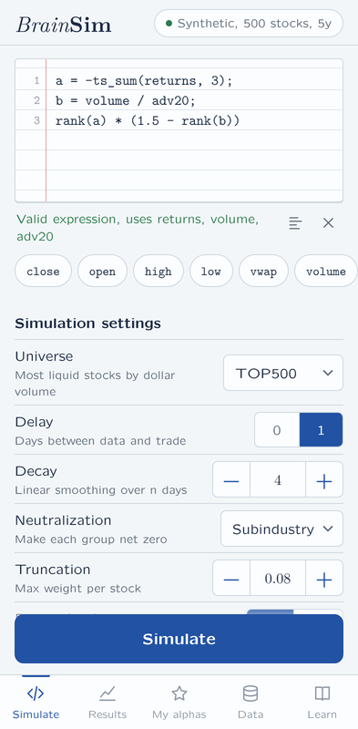
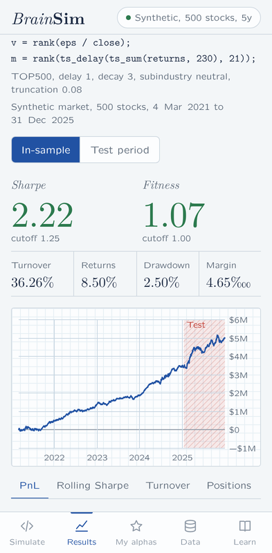
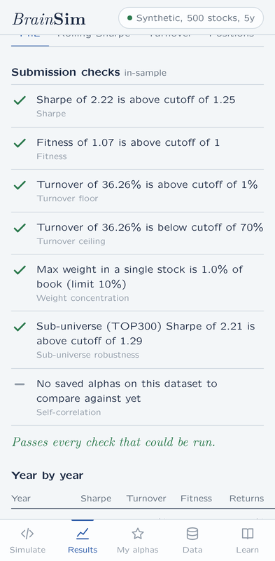

# BrainSim

An Android app for writing and backtesting WorldQuant BRAIN–style alpha expressions on your phone, fully offline.

Type an expression such as `rank(-ts_delta(close, 5))`, choose the usual BRAIN settings (universe, delay, decay, neutralization, truncation, pasteurization, NaN handling, test period) and tap **Simulate**. In under a second you get Sharpe, turnover, fitness, returns, drawdown and margin, a cumulative PnL chart, a year-by-year table, the in-sample submission checks, and the largest positions.

<p>



</p>

## Get the APK

You need to build it once. Pick whichever is easiest:

**A. GitHub Actions (no installs needed).** Create a new GitHub repository, push this folder to it, and open the **Actions** tab. The *Build APK* workflow runs automatically. When it finishes, download the `BrainSim-apk` artifact, which contains `BrainSim.apk`. If you push a tag such as `v1.0.0`, the APK is also attached to a GitHub Release.

```bash
git init && git add . && git commit -m "BrainSim"
git branch -M main
git remote add origin https://github.com/<you>/BrainSim.git
git push -u origin main
```

**B. Android Studio.** Open this folder with *File › Open*, let Gradle sync, plug in your phone (USB debugging on) and press **Run**. *Build › Build APK(s)* writes `app/build/outputs/apk/debug/app-debug.apk`.

**C. Command line.** With JDK 17 and the Android SDK installed (`ANDROID_HOME` set):

```bash
./gradlew assembleRelease     # app/build/outputs/apk/release/app-release.apk
```

To install, copy the APK to your phone, open it, and allow *Install unknown apps* for your file manager when asked. The release APK is signed with the debug key so it installs directly; use your own key before publishing it anywhere.

Requirements: Android 8.0 (API 26) or newer. No permissions other than internet access, which is used only when you download real prices.

## Using the app

**Simulate.** Write the expression in the editor. Tap the chips to insert data fields, groups and common operators; the list icon opens 14 example alphas. The line under the editor validates as you type and points to the exact line and column of any mistake, with suggestions for misspelt names. Multi-line expressions with variables work the same way as on BRAIN:

```
a = -ts_sum(returns, 3);
b = volume / adv20;
rank(a) * (1.5 - rank(b))
```

**Results.** Shows Sharpe and fitness against their cutoffs, the four secondary metrics, and a chart you can scrub with your finger: PnL, rolling one-year Sharpe, turnover, or long and short counts. A test period you set in the settings is hatched on the chart and reported separately. Below that are the submission checks, the yearly table and the largest long and short positions. You can save the alpha, load it back into the editor, export the daily PnL as CSV, or share a text summary.

**My alphas.** Every run is kept; saved alphas are kept permanently and are what the self-correlation check compares against. Filter by saved or passing.

**Data.** Switch between three sources:

- *Synthetic market* (default, offline). 100 to 1,000 stocks over 2 to 10 years, generated on the device from a seed. It has a market factor with volatility regimes, sector, industry and sub-industry factors, fat-tailed stock noise, listings and delistings, quarterly fundamentals, and weak built-in effects (short-term reversal, momentum, value, profitability, low volatility) so classic alphas behave plausibly.
- *Real US large caps.* Downloads adjusted daily prices for 127 large US stocks with GICS-style sectors from Yahoo Finance, falling back to Stooq per ticker. Takes about a minute and is then stored on the device.
- *CSV import.* Long format, one row per stock per day: `date,ticker,close` are required; `open,high,low,volume,vwap,sharesout,sector,industry,subindustry` are optional, and every other numeric column becomes a data field you can use in expressions.

**Learn.** Searchable reference for all 94 operators with an Insert button, the data fields of the current dataset, and an explanation of the pipeline, the metrics and the checks.

## What is simulated

The pipeline follows BRAIN's documented behaviour:

1. Universe: the top N stocks by 20-day average dollar volume, re-ranked every 21 trading days.
2. Pasteurization: data outside the universe is hidden from the expression.
3. The expression is evaluated for every stock and day (time-series operators look only backwards).
4. Delay 0 or 1, then linear decay over n days.
5. Neutralization by market, sector, industry or sub-industry.
6. Scale to a $20M book (long plus short), then cap each stock at the truncation limit.
7. PnL is the next day's return on those weights.

Metrics: Sharpe = mean/std of daily PnL × √252; turnover = average of Σ|Δw| / Σ|w|; returns = annualised PnL / $10M; drawdown = largest peak-to-trough drop / $10M; margin = PnL per dollar traded (‱); fitness = Sharpe × √(|returns| / max(turnover, 0.125)).

Checks: Sharpe ≥ 1.25 and fitness ≥ 1.0 for delay 1 (2.0 and 1.3 for delay 0), turnover between 1% and 70%, no stock above 10% of the book, a sub-universe robustness test, and self-correlation below 0.7 against your saved alphas.

Operators (94): arithmetic (`abs`, `log`, `signed_power`, `max`, `s_log_1p`, …), logical (`if_else`, `and`, comparisons, `? :`), time series (`ts_delta`, `ts_mean`, `ts_std_dev`, `ts_rank`, `ts_corr`, `ts_covariance`, `ts_regression`, `ts_decay_linear`, `ts_backfill`, `ts_zscore`, `ts_arg_max`, `ts_quantile`, …), cross-sectional (`rank`, `zscore`, `scale`, `normalize`, `quantile`, `winsorize`, `regression_neut`, …), group (`group_neutralize`, `group_rank`, `group_zscore`, `group_mean`, `bucket`, …) and transformational (`trade_when`, `hump`, `tail`, …).

## How close is this to BRAIN?

The expression language, settings, pipeline, metrics and check thresholds mirror the platform. The data is the main difference: BRAIN has thousands of stocks and hundreds of datasets, while this app has a synthetic market, 127 real large caps, or your own CSV. Use it to learn the language, practise, and screen ideas away from a computer, then confirm on BRAIN. Small details, such as the exact sub-universe cutoff, are approximations.

## Project layout

```
app/src/main/java/com/brainsim/app/MainActivity.java   Native shell: WebView, asset server, bridge
app/src/main/assets/www/engine.js                      Parser, operators, simulator, statistics
app/src/main/assets/www/data.js                        Synthetic market, downloads, CSV, caching
app/src/main/assets/www/app.js                         UI logic and persistence
app/src/main/assets/www/chart.js                       Canvas charts
app/src/main/assets/www/index.html, styles.css, fonts/ Layout, styling, Latin Modern fonts
tests/engine.test.js                                   Engine unit tests (node)
tests/calibrate.js                                     Runs textbook alphas on the synthetic market
tests/ui_test.py                                       Headless phone-size UI test (Playwright)
.github/workflows/build-apk.yml                        Cloud build of the APK
```

The app has no third-party dependencies. The engine is plain JavaScript and runs inside the app's WebView, served from a local `https://appassets.androidplatform.net` origin so nothing is fetched from the network. A small Java bridge adds file storage, cross-origin downloads, the system save dialog and the share sheet.

## Development

```bash
node tests/engine.test.js          # 31 unit tests
node tests/calibrate.js 500 5 42   # stats for ~20 classic alphas
python3 tests/ui_test.py /tmp/shots
```

The web part also runs in a desktop browser: serve `app/src/main/assets/www` with any static server (for example `python3 -m http.server`). Everything works there except downloading real prices, which browsers block. To debug inside the app, run a debug build and open `chrome://inspect` on your computer.

## Notes

- This is an independent learning tool and is not affiliated with or endorsed by WorldQuant. "WorldQuant BRAIN" is their trademark.
- Results on the synthetic market are illustrative only. Nothing here is investment advice.
- Yahoo Finance and Stooq endpoints are unofficial and may change or rate-limit. If a download fails, try again later or import a CSV.
- Fonts: Latin Modern by B. Jackowski and J. M. Nowacki, under the GUST Font License (see `app/src/main/assets/www/fonts/LICENSE.txt`).
